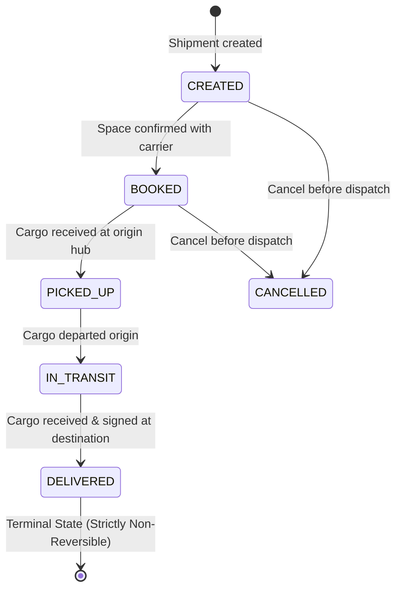
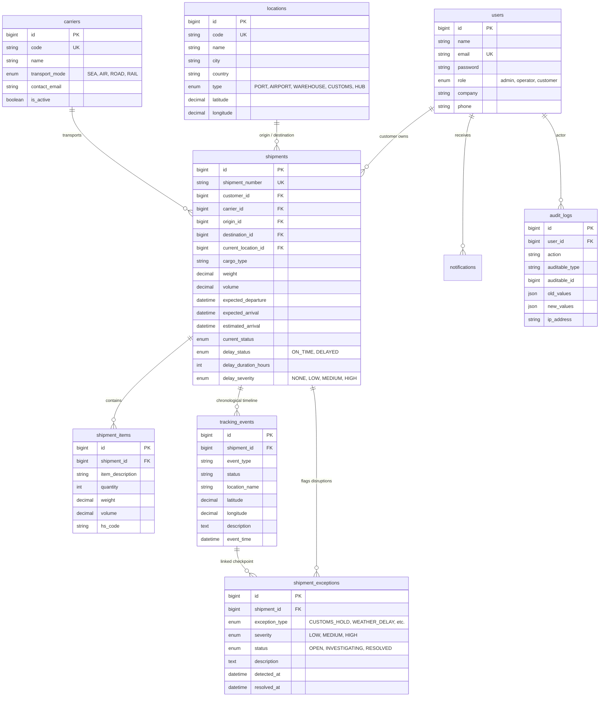

# CargoTrace &bull; Global Shipment Visibility & Tracking Platform
> **Web Programming 2 &bull; Final Project (UAS)**  
> *Build a software portfolio project &mdash; not just a CRUD website.*

[](https://laravel.com/)
[](https://www.php.net/)
[](https://tailwindcss.com/)
[](https://leafletjs.com/)
[-success?style=flat)](tests)
[](LICENSE)

---

## 1. Problem Statement & Solution Overview

### The Problem
International freight forwarding and multi-modal logistics operations suffer from fragmented shipment visibility:
- **Disparate updates**: Milestones reside across carrier emails, customs EDI feeds, and port portals.
- **Customer friction**: Consignees lack chronological tracking timelines and real-time geographical visibility.
- **Unmanaged disruptions**: Bottlenecks like customs holds, port congestions, and weather gales are detected reactively without structured exception workflows.
- **Lack of operational intelligence**: Operations managers lack centralized delay duration metrics, delay severity indicators, and carrier reliability comparisons.

### The CargoTrace Solution
CargoTrace is a full-featured shipment tracking and visibility platform built strictly following software engineering standards:
- **Strict State Machine**: End-to-end shipment lifecycle progression (`CREATED` &rarr; `BOOKED` &rarr; `PICKED_UP` &rarr; `IN_TRANSIT` &rarr; `DELIVERED`), with irreversible terminal state protection.
- **Deterministic Delay & ETA Engine**: Real-time variance calculation between expected and estimated arrival, automatically classifying delay severity (`LOW`, `MEDIUM`, `HIGH`) and adapting to configurable scenario thresholds (12h, 18h, 24h).
- **Interactive Waypoint Mapping**: Integrated Leaflet.js with OpenStreetMap to render maritime/air corridors, intermediate transit hubs, and exception coordinates.
- **Live External Service Integrations**: Real-time geocoding via OpenStreetMap Nominatim and atmospheric weather via Open-Meteo with network timeout resilience and graceful fallbacks.
- **Full REST API Suite with Laravel Sanctum**: Token-based authentication, server-side authorization, JSON error contracts, and complete Postman collection.
- **Rigorous Automated Testing**: 22 automated feature tests covering authentication, RBAC data isolation, state machine transitions, delay math, and REST endpoints.

---

## 2. System Architecture

CargoTrace strictly adheres to a **Layered Architecture Pattern** that decouples HTTP presentation from domain logic, ensuring maintainability, testability, and clean code ownership:

```
+-------------------------------------------------------------------------------+
|                       Browser Client / REST API Client                       |
+-------------------------------------------------------------------------------+
                                      |
                                      v
+-------------------------------------------------------------------------------+
|               Routes & Middleware (auth, role, sanctum, csrf)                |
+-------------------------------------------------------------------------------+
                                      |
                                      v
+-------------------------------------------------------------------------------+
|             Controllers (HTTP Request Handling & JSON / View Binding)        |
+-------------------------------------------------------------------------------+
                                      |
                                      v
+-------------------------------------------------------------------------------+
|                        Business Service Layer (Core Logic)                    |
|  - ShipmentService    : State machine, validations, transactional saves       |
|  - TrackingService    : Immutable historical timelines & location updates    |
|  - EtaService         : Deterministic delay variance & threshold tiers       |
|  - ExceptionService   : Disruption lifecycles (Open -> Investigating -> Done)|
|  - ExternalApiService : Resilient HTTP Client (Nominatim + Open-Meteo)        |
|  - AuditService       : Security and change audit logging                    |
|  - NotificationService: In-app broadcast & targeted alerts                   |
+-------------------------------------------------------------------------------+
                                      |
                                      v
+-------------------------------------------------------------------------------+
|                  Eloquent ORM & Data Layer (MySQL 8.0 / SQLite)               |
+-------------------------------------------------------------------------------+
```

---

## 3. User Roles & Permission Matrix (RBAC)

All endpoints and controllers verify role permissions on the server:

| Feature / Resource | Administrator | Logistics Operator | Customer |
|---|:---:|:---:|:---:|
| System Configuration & Delay Thresholds | :white_check_mark: | :x: | :x: |
| Carrier Line Management (CRUD) | :white_check_mark: | Read Only | Read Only |
| Node & Hub Location Management | :white_check_mark: | Read Only | Read Only |
| View All Consignments & Analytics | :white_check_mark: | :white_check_mark: | Own Shipments Only |
| Create & Edit Shipments | :white_check_mark: | :white_check_mark: | :x: |
| Advance Status Lifecycle | :white_check_mark: | :white_check_mark: | :x: |
| Record Tracking Checkpoints | :white_check_mark: | :white_check_mark: | :x: |
| Flag & Resolve Exceptions | :white_check_mark: | :white_check_mark: | View Relevant Only |
| Delete Consignment | :white_check_mark: | :x: | :x: |
| Inspect Security Audit Logs | :white_check_mark: | :x: | :x: |

---

## 4. Shipment Lifecycle State Machine



### Business Rules Enforced in Backend:
1. **No Hopping**: Jumps from `CREATED` directly to `DELIVERED` are rejected with HTTP 422 `ValidationException`.
2. **Terminal Integrity**: Once a shipment reaches `DELIVERED` or `CANCELLED`, any status reversal attempt throws an exception.
3. **Automatic Coordinates**: Advancing status or recording a checkpoint updates the consignment's `current_location_id` and latest map pin.

---

## 5. ETA & Deterministic Delay Rules

$$\Delta t = \text{estimated\_arrival} - \text{expected\_arrival}$$

- If $\Delta t \le 0$: status is `ON_TIME` with `NONE` severity.
- If $0 < \Delta t \le 6\text{ hours}$: status is `DELAYED` with `LOW` severity.
- If $6 < \Delta t \le 24\text{ hours}$: status is `DELAYED` with `MEDIUM` severity.
- If $\Delta t > 24\text{ hours}$: status is `DELAYED` with `HIGH` critical severity.

### Group Scenarios Configured (Slide 20 & 23):
- **Group A Scenario**: Southeast Asia &rarr; Europe (`CT-2026-EUR01`), 12h threshold, Primary Exception: Customs Hold.
- **Group B Scenario**: Asia &rarr; North America (`CT-2026-USA02`), 18h threshold, Primary Exception: Weather Delay.
- **Group C Scenario**: Southeast Asia &rarr; Australia (`CT-2026-AUS03`), 24h threshold, Delivered on time.

*The threshold parameter is configurable via `GROUP_DELAY_THRESHOLD_HOURS` in `.env`.*

---

## 6. Entity Relationship Diagram (ERD) & Data Model



---

## 7. Interactive Map & External API Integration

- **Leaflet.js + OpenStreetMap**: Renders high-resolution interactive map tiles, origin/destination pins, historical tracking coordinates, and route polylines. Includes required copyright attributions.
- **Geocoding API**: Uses OpenStreetMap Nominatim for automated coordinate discovery with caching.
- **Weather API**: Queries live ambient temperature, wind velocity, and condition reports via Open-Meteo.
- **Fault Tolerance**: Requests use a strict 4-second timeout limit. If external networks are offline or rate-limited, fallback data is applied to prevent application failure.

---

## 8. Demo User Accounts

The seeders provide ready-to-test accounts for each role. Quick 1-click login buttons are also available on the login page:

| Role | Email Address | Password | Permissions & Scope |
|---|---|---|---|
| **Administrator** | `admin@cargotrace.test` | `password` | Full system control, carriers, locations, audit logs, all shipments |
| **Logistics Operator** | `operator@cargotrace.test` | `password` | Create shipments, transition statuses, add checkpoints, resolve exceptions |
| **Customer (Primary)** | `customer@cargotrace.test` | `password` | PT Global Tech Solusindo &bull; Own shipments, map, timeline, alerts |
| **Customer (Secondary)**| `pacific@cargotrace.test` | `password` | Pacific Agro Trading Pte Ltd &bull; Isolated consignments |

---

## 9. Local Installation & Setup Guide

### Prerequisites
- PHP 8.2 or higher
- Composer 2.x
- MySQL 8.0+ (or XAMPP / MariaDB)

### Steps

1. **Clone or Navigate to the Repository**:
   ```bash
   cd cargotrace
   ```

2. **Install PHP Dependencies**:
   ```bash
   composer install
   ```

3. **Configure Environment Variables**:
   ```bash
   cp .env.example .env
   php artisan key:generate
   ```
   *Verify your MySQL database credentials in `.env`:*
   ```ini
   DB_CONNECTION=mysql
   DB_HOST=127.0.0.1
   DB_PORT=3306
   DB_DATABASE=cargotrace
   DB_USERNAME=root
   DB_PASSWORD=
   ```

4. **Run Migrations & Seeders**:
   ```bash
   php artisan migrate:fresh --seed
   ```

5. **Start the Local Development Server**:
   ```bash
   php artisan serve
   ```
   Open your browser and navigate to: **`http://127.0.0.1:8000`**

---

## 10. Automated Testing

Run the test suite via Artisan:

```bash
php artisan test
```

### Test Evidence:
```
   PASS  Tests\Unit\ExampleTest
  ✓ that true is true

   PASS  Tests\Feature\ApiEndpointsTest
  ✓ unauthenticated request is rejected with 401
  ✓ authenticated user can retrieve paginated shipments
  ✓ operator can record tracking event via api
  ✓ operator can raise and resolve exception via api

   PASS  Tests\Feature\AuthenticationTest
  ✓ user can login with valid credentials
  ✓ user cannot login with invalid password
  ✓ guest cannot access dashboard and is redirected to login
  ✓ api login returns sanctum token

   PASS  Tests\Feature\AuthorizationTest
  ✓ customer can view their own shipment
  ✓ customer cannot view another customers shipment
  ✓ customer cannot delete shipment
  ✓ admin can delete shipment

   PASS  Tests\Feature\EtaDelayCalculationTest
  ✓ evaluates on time when eta matches or is earlier than expected
  ✓ evaluates low severity delay under 6 hours
  ✓ evaluates medium severity delay between 6 and 24 hours
  ✓ evaluates high severity delay over 24 hours

   PASS  Tests\Feature\ExampleTest
  ✓ guest is redirected to login
  ✓ authenticated user is redirected to dashboard

   PASS  Tests\Feature\ShipmentLifecycleTest
  ✓ valid shipment lifecycle progression
  ✓ invalid status jump is strictly rejected
  ✓ terminal delivered status cannot be reverted

  Tests:    22 passed (75 assertions)
  Duration: 3.61s
```

---

## 11. REST API Documentation & Postman Collection

The repository includes a ready-to-import Postman collection:  
**[`cargotrace_postman_collection.json`](./cargotrace_postman_collection.json)**

### Core API Endpoints

#### Authentication:
- `POST /api/register` &mdash; Create customer account
- `POST /api/login` &mdash; Obtain Bearer API token
- `POST /api/logout` &mdash; Invalidate current token
- `GET /api/user` &mdash; Get current authenticated user

#### Shipments:
- `GET /api/shipments` &mdash; Paginated shipments list with filters (`status`, `carrier_id`, `delay_status`)
- `POST /api/shipments` &mdash; Create new shipment (Operator / Admin)
- `GET /api/shipments/{id}` &mdash; Full shipment details with waypoints
- `PUT/PATCH /api/shipments/{id}` &mdash; Update shipment attributes
- `DELETE /api/shipments/{id}` &mdash; Soft delete shipment (Admin)

#### Tracking Timeline & Checkpoints:
- `GET /api/shipments/{id}/tracking` &mdash; Chronological tracking timeline
- `POST /api/shipments/{id}/tracking` &mdash; Record checkpoint event

#### Disruption Exceptions:
- `GET /api/shipments/{id}/exceptions` &mdash; List shipment exceptions
- `POST /api/shipments/{id}/exceptions` &mdash; Flag new exception
- `PATCH /api/exceptions/{id}` &mdash; Update exception status to `INVESTIGATING` or `RESOLVED`

#### Master Data:
- `GET /api/carriers` &mdash; Active carriers
- `GET /api/locations` &mdash; Terminal hubs and seaports

---

## 12. Docker Deployment

Deploy with Docker and Docker Compose:

```bash
docker compose up -d --build
```

The application will be accessible at `http://localhost:8000` connected to MySQL 8.0 on container network `cargotrace_network`.

---

## 13. Known Limitations & Future Work

- **Known Limitations**:
  - AIS maritime live transponder satellite feeds are simulated using accurate coordinate waypoints.
  - SMS carrier alerts are simulated via database in-app notifications.
- **Future Enhancements**:
  - Real-time IoT temperature/humidity telematics streaming via WebSockets (Laravel Reverb).
  - Multi-tenant sub-accounts for logistics third-party brokers (3PL).
  - Integration with Port Community Systems via EDIFACT / AS2 protocols.

---

## 14. Attributions & External Libraries

- **Framework**: [Laravel 11](https://laravel.com)
- **Styling**: [Tailwind CSS](https://tailwindcss.com)
- **Maps**: [Leaflet.js](https://leafletjs.com) &copy; Leaflet contributors, Map tiles &copy; [OpenStreetMap contributors](https://www.openstreetmap.org/copyright)
- **Geocoding**: [OpenStreetMap Nominatim](https://nominatim.openstreetmap.org)
- **Weather Services**: [Open-Meteo Weather Forecast API](https://open-meteo.com)
- **Charts**: [Chart.js](https://www.chartjs.org)
- **Reactivity**: [Alpine.js](https://alpinejs.dev)
