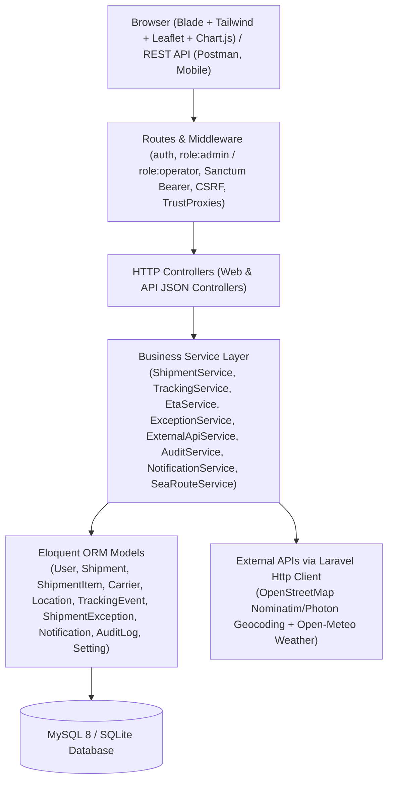
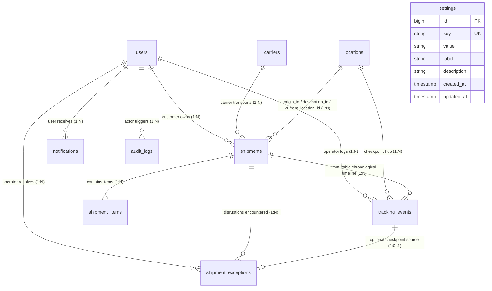

# CargoTrace — ERD, Data Dictionary & Architecture Documentation

> Technical deliverable for **Web Programming 2 • UAS Final Project**  
> Complies with **Slide 11 (Minimum Data Model)**, **Slide 15 (Layered Architecture)**, and **Slide 18 (Technical Documentation)**.

---

## 1. System Architecture Diagram

CargoTrace isolates HTTP request/response handling from domain rules using a strict 4-tier architecture:

---

## 2. Entity Relationship Diagram (ERD)

### Cardinality & Key Design Decisions (Interview Reference — Slide 11 & 19)
1. **`users` 1:N `shipments` (`hasMany` via `customer_id`)**: A customer owns multiple consignments; every shipment belongs to a single consignee (`ON DELETE CASCADE` or query scoped via `scopeForUser()` so customers are isolated to their own records).
2. **`shipments` 1:N `shipment_items` (`hasMany`)**: One consignment manifest can contain multiple line items/lots with individual quantities, weights, volumes, and HS codes (`ON DELETE CASCADE`).
3. **`shipments` 1:N `tracking_events` (`hasMany`, ordered chronologically by `event_time` ASC)**: Historical checkpoints are **append-only / immutable**. Updating status never overwrites previous history, preserving a full audit trail of physical coordinates and actors.
4. **`carriers` & `locations` 1:N `shipments` (`ON DELETE RESTRICT`)**: Referential integrity strictly prevents deleting a carrier line or terminal hub while shipments still reference it; administrators deactivate unused carriers instead.
5. **Soft Deletes (`softDeletes`) Only Where Needed (Slide 11)**: Applied exclusively to `shipments` so accidental or test deletions remain recoverable and linked `audit_logs` remain traceable; reference masters (`carriers`, `locations`) and append-only logs (`tracking_events`, `audit_logs`) do not use soft deletes blindly.

---

## 3. Complete Data Dictionary

### Table 1: `users`
| Column | Type | Constraints / Index | Description |
|---|---|---|---|
| `id` | `bigint unsigned` | `PK`, `AUTO_INCREMENT` | Primary user identifier |
| `name` | `varchar(255)` | `NOT NULL` | Display / legal name |
| `email` | `varchar(255)` | `UNIQUE`, `NOT NULL` | Login identifier |
| `password` | `varchar(255)` | `NOT NULL` | Bcrypt-hashed password |
| `role` | `enum/varchar` | `NOT NULL`, default `customer` | RBAC role: `admin`, `operator`, or `customer` |
| `company` | `varchar(255)` | `NULLABLE` | Company or organization name |
| `phone` | `varchar(50)` | `NULLABLE` | Contact phone number |
| `remember_token` | `varchar(100)` | `NULLABLE` | Session remember-me token |
| `created_at`, `updated_at` | `timestamp` | `NULLABLE` | Standard audit timestamps |

### Table 2: `carriers`
| Column | Type | Constraints / Index | Description |
|---|---|---|---|
| `id` | `bigint unsigned` | `PK`, `AUTO_INCREMENT` | Primary carrier identifier |
| `code` | `varchar(20)` | `UNIQUE`, `NOT NULL` | Short carrier code (e.g., `MSK`, `MSC`, `EVG`) |
| `name` | `varchar(100)` | `NOT NULL` | Carrier legal/trading name |
| `transport_mode` | `enum` | `NOT NULL` | `SEA`, `AIR`, `ROAD`, `RAIL` |
| `contact_email` | `varchar(100)` | `NULLABLE` | Carrier operations email |
| `contact_phone` | `varchar(50)` | `NULLABLE` | Carrier dispatch phone |
| `website` | `varchar(150)` | `NULLABLE` | Official carrier website |
| `is_active` | `boolean` | `DEFAULT true` | Active operational availability flag |
| `created_at`, `updated_at` | `timestamp` | `NULLABLE` | Standard timestamps |

### Table 3: `locations`
| Column | Type | Constraints / Index | Description |
|---|---|---|---|
| `id` | `bigint unsigned` | `PK`, `AUTO_INCREMENT` | Primary location hub identifier |
| `code` | `varchar(20)` | `UNIQUE`, `NOT NULL` | UN/LOCODE or facility code (e.g., `BRSSZ`, `IDTPP`) |
| `name` | `varchar(100)` | `NOT NULL` | Port, airport, warehouse, or hub name |
| `city` | `varchar(100)` | `NOT NULL` | City name |
| `country` | `varchar(100)` | `NOT NULL` | Country name |
| `type` | `enum` | `NOT NULL` | `PORT`, `AIRPORT`, `WAREHOUSE`, `CUSTOMS`, `HUB` |
| `latitude` | `decimal(10,7)` | `NULLABLE` | Geographic WGS84 latitude |
| `longitude` | `decimal(10,7)` | `NULLABLE` | Geographic WGS84 longitude |
| `address` | `text` | `NULLABLE` | Street or terminal berth description |
| `created_at`, `updated_at` | `timestamp` | `NULLABLE` | Standard timestamps |

### Table 4: `shipments`
| Column | Type | Constraints / Index | Description |
|---|---|---|---|
| `id` | `bigint unsigned` | `PK`, `AUTO_INCREMENT` | Primary shipment identifier |
| `shipment_number` | `varchar(50)` | `UNIQUE`, `NOT NULL` | Tracking reference code (e.g., `CT-2026-CRN01`) |
| `customer_id` | `bigint unsigned` | `FK -> users(id)` (`CASCADE`) | Owning consignee customer |
| `carrier_id` | `bigint unsigned` | `FK -> carriers(id)` (`RESTRICT`) | Assigned carrier line |
| `origin_id` | `bigint unsigned` | `FK -> locations(id)` (`RESTRICT`) | Origin hub/port |
| `destination_id` | `bigint unsigned` | `FK -> locations(id)` (`RESTRICT`) | Destination hub/port |
| `current_location_id` | `bigint unsigned` | `FK -> locations(id)` (`SET NULL`) | Latest known registered facility |
| `cargo_type` | `varchar(100)` | `NOT NULL` | Cargo classification / commodity |
| `weight` | `decimal(12,2)` | `NOT NULL` | Gross consignment weight (Metric Tons) |
| `volume` | `decimal(12,2)` | `NULLABLE` | Stowage volume in CBM |
| `expected_departure` | `datetime` | `NOT NULL` | Planned departure timestamp |
| `expected_arrival` | `datetime` | `NOT NULL` | Contractual arrival deadline |
| `actual_departure` | `datetime` | `NULLABLE` | Populated upon `IN_TRANSIT` transition |
| `actual_arrival` | `datetime` | `NULLABLE` | Populated upon `DELIVERED` transition |
| `estimated_arrival` | `datetime` | `NOT NULL` | Current deterministic ETA |
| `current_status` | `enum` | `INDEX`, default `CREATED` | `CREATED`, `BOOKED`, `PICKED_UP`, `IN_TRANSIT`, `DELIVERED`, `CANCELLED` |
| `delay_status` | `enum` | `INDEX`, default `ON_TIME` | `ON_TIME`, `DELAYED` |
| `delay_duration_hours` | `int` | `DEFAULT 0` | Calculated hours past `expected_arrival` |
| `delay_severity` | `enum` | `DEFAULT NONE` | `NONE`, `LOW`, `MEDIUM`, `HIGH` |
| `delay_reason` | `text` | `NULLABLE` | Computed explanation & threshold metadata |
| `notes` | `text` | `NULLABLE` | Operational handling notes |
| `deleted_at` | `timestamp` | `NULLABLE` | Soft delete recovery timestamp |
| `created_at`, `updated_at` | `timestamp` | `NULLABLE` | Standard timestamps |

### Table 5: `shipment_items`
| Column | Type | Constraints / Index | Description |
|---|---|---|---|
| `id` | `bigint unsigned` | `PK`, `AUTO_INCREMENT` | Primary item identifier |
| `shipment_id` | `bigint unsigned` | `FK -> shipments(id)` (`CASCADE`) | Parent consignment |
| `item_description` | `varchar(200)` | `NOT NULL` | Item description / manifest lot name |
| `quantity` | `int` | `NOT NULL` | Lot / package quantity |
| `weight` | `decimal(12,2)` | `NOT NULL` | Item weight |
| `volume` | `decimal(12,2)` | `NULLABLE` | Item volume (CBM) |
| `hs_code` | `varchar(50)` | `NULLABLE` | Harmonized System customs tariff code |
| `package_type` | `varchar(50)` | `NULLABLE` | Hold / container / packaging type |
| `grade_specification` | `varchar(255)` | `NULLABLE` | Optional quality specification |
| `moisture_content_percent` | `decimal(5,2)` | `NULLABLE` | Optional cargo moisture telemetry |
| `created_at`, `updated_at` | `timestamp` | `NULLABLE` | Standard timestamps |

### Table 6: `tracking_events`
| Column | Type | Constraints / Index | Description |
|---|---|---|---|
| `id` | `bigint unsigned` | `PK`, `AUTO_INCREMENT` | Primary event identifier |
| `shipment_id` | `bigint unsigned` | `FK -> shipments(id)` (`CASCADE`) | Parent shipment |
| `event_type` | `varchar(50)` | `NOT NULL` | `STATUS_UPDATE`, `CHECKPOINT`, `EXCEPTION_FLAG`, `EXCEPTION_RESOLVED` |
| `status` | `varchar(30)` | `NOT NULL` | Lifecycle status snapshot at event time |
| `location_id` | `bigint unsigned` | `FK -> locations(id)` (`SET NULL`) | Optional normalized location reference |
| `location_name` | `varchar(150)` | `NOT NULL` | Human-readable hub/waypoint location |
| `latitude` | `decimal(10,7)` | `NULLABLE` | Checkpoint GPS latitude |
| `longitude` | `decimal(10,7)` | `NULLABLE` | Checkpoint GPS longitude |
| `description` | `text` | `NOT NULL` | Operational checkpoint notes |
| `event_time` | `datetime` | `INDEX`, `NOT NULL` | Chronologically validated event timestamp |
| `created_by` | `bigint unsigned` | `FK -> users(id)` (`SET NULL`) | Author user ID |
| `created_at`, `updated_at` | `timestamp` | `NULLABLE` | Standard timestamps |

### Table 7: `shipment_exceptions`
| Column | Type | Constraints / Index | Description |
|---|---|---|---|
| `id` | `bigint unsigned` | `PK`, `AUTO_INCREMENT` | Primary exception identifier |
| `shipment_id` | `bigint unsigned` | `FK -> shipments(id)` (`CASCADE`) | Parent shipment |
| `tracking_event_id` | `bigint unsigned` | `FK -> tracking_events(id)` (`SET NULL`) | Associated timeline flag event |
| `exception_type` | `enum` | `NOT NULL` | `CUSTOMS_HOLD`, `WEATHER_DELAY`, `PORT_CONGESTION`, `DAMAGED`, `MISROUTED`, `DOCUMENTATION_ISSUE` |
| `severity` | `enum` | `NOT NULL` | `LOW`, `MEDIUM`, `HIGH` |
| `status` | `enum` | `DEFAULT OPEN` | `OPEN`, `INVESTIGATING`, `RESOLVED` |
| `description` | `text` | `NOT NULL` | Root cause description |
| `resolution_notes` | `text` | `NULLABLE` | Resolution summary logged by operator |
| `detected_at` | `datetime` | `NOT NULL` | Timestamp when exception occurred |
| `resolved_at` | `datetime` | `NULLABLE` | Timestamp when marked `RESOLVED` |
| `resolved_by` | `bigint unsigned` | `FK -> users(id)` (`SET NULL`) | Operator who resolved it |
| `created_at`, `updated_at` | `timestamp` | `NULLABLE` | Standard timestamps |

### Table 8: `notifications`
| Column | Type | Constraints / Index | Description |
|---|---|---|---|
| `id` | `bigint unsigned` | `PK`, `AUTO_INCREMENT` | Primary notification identifier |
| `user_id` | `bigint unsigned` | `FK -> users(id)` (`CASCADE`) | Recipient user |
| `title` | `varchar(150)` | `NOT NULL` | Short alert title |
| `message` | `text` | `NOT NULL` | Alert details |
| `type` | `varchar(30)` | `DEFAULT info` | `info`, `success`, `warning`, `danger` |
| `link` | `varchar(255)` | `NULLABLE` | Deep link to related shipment/exception |
| `is_read` | `boolean` | `DEFAULT false` | Read indicator |
| `read_at` | `timestamp` | `NULLABLE` | Timestamp read by user |
| `created_at`, `updated_at` | `timestamp` | `NULLABLE` | Standard timestamps |

### Table 9: `audit_logs`
| Column | Type | Constraints / Index | Description |
|---|---|---|---|
| `id` | `bigint unsigned` | `PK`, `AUTO_INCREMENT` | Primary audit entry identifier |
| `user_id` | `bigint unsigned` | `FK -> users(id)` (`SET NULL`) | Actor who performed action |
| `action` | `varchar(100)` | `INDEX`, `NOT NULL` | Action code (e.g., `CREATED`, `STATUS_CHANGE`, `SYSTEM_CONFIG_UPDATED`) |
| `auditable_type` | `varchar(150)` | `NOT NULL` | Target model class name |
| `auditable_id` | `bigint unsigned` | `NULLABLE` | Target model ID |
| `old_values` | `json` | `NULLABLE` | Pre-mutation snapshot |
| `new_values` | `json` | `NULLABLE` | Post-mutation snapshot |
| `ip_address` | `varchar(45)` | `NULLABLE` | Client IP address |
| `user_agent` | `varchar(255)` | `NULLABLE` | Client User-Agent header |
| `created_at` | `timestamp` | `NOT NULL` | Immutable audit timestamp |

### Table 10: `settings`
| Column | Type | Constraints / Index | Description |
|---|---|---|---|
| `id` | `bigint unsigned` | `PK`, `AUTO_INCREMENT` | Setting primary key |
| `key` | `varchar(100)` | `UNIQUE`, `NOT NULL` | Config key (e.g., `group_delay_threshold_hours`) |
| `value` | `varchar(255)` | `NULLABLE` | Configured value |
| `label` | `varchar(150)` | `NULLABLE` | Human-readable label |
| `description` | `varchar(500)` | `NULLABLE` | Help text explaining threshold behavior |
| `created_at`, `updated_at` | `timestamp` | `NULLABLE` | Standard timestamps |
